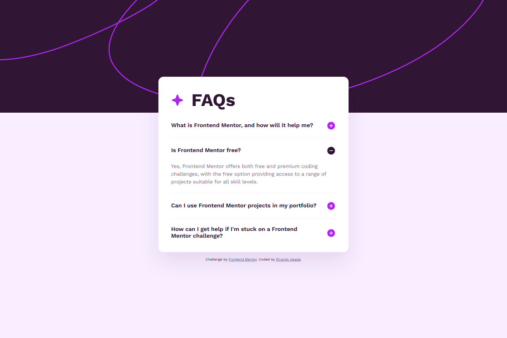

# Frontend Mentor - FAQ accordion solution

This is a solution to the [FAQ accordion challenge on Frontend Mentor](https://www.frontendmentor.io/challenges/faq-accordion-wyfFdeBwBz). Frontend Mentor challenges help you improve your coding skills by building realistic projects. 

## Table of contents

- [Overview](#overview)
  - [The challenge](#the-challenge)
  - [Screenshot](#screenshot)
  - [Links](#links)
- [My process](#my-process)
  - [Built with](#built-with)
  - [What I learned](#what-i-learned)
  - [Continued development](#continued-development)
  - [Useful resources](#useful-resources)
- [Author](#author)

## Overview

### The challenge

Users should be able to:

- Hide/Show the answer to a question when the question is clicked
- Navigate the questions and hide/show answers using keyboard navigation alone
- View the optimal layout for the interface depending on their device's screen size
- See hover and focus states for all interactive elements on the page

### Screenshot

### Links

- Solution URL: [github.com/RicardoGeada/fm-faq-accordion/](https://github.com/RicardoGeada/fm-faq-accordion/)
- Live Site URL: [ricardogeada.github.io/fm-faq-accordion/](https://ricardogeada.github.io/fm-faq-accordion/)

## My process

### Built with

- Semantic HTML5 markup
- CSS custom properties
- Flexbox
- CSS Grid
- Mobile-first workflow

### What I learned

I learned that you don't always need JavaScript to create interactive elements. HTML provides built-in elements for specific use cases, such as the 
 and 
 elements for creating an accessible accordion.

Using semantic HTML makes it easier to build interactive components with built-in keyboard support and accessibility features, while keeping the code simple.

### Continued development

Accessibility is an important topic, and I want to deepen my knowledge with every project I build. I especially want to improve my understanding of semantic HTML, keyboard navigation, and screen reader support.

### Useful resources

- [The A11y Project - Checklist](https://www.a11yproject.com/checklist/) - This checklist helped me review my project for potential accessibility issues.

## Author

- Website - [ricardogeada.com](https://www.ricardogeada.com)
- Frontend Mentor - [@RicardoGeada](https://www.frontendmentor.io/profile/RicardoGeada)

